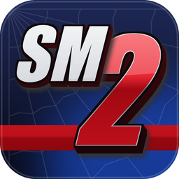

<p align="center"></p>

# sm2port

An unofficial native Windows port of **Spider-Man 2** for the original Xbox (the Italian, the European
French/German/Spanish and the World releases). It runs the game from **your own disc image**, with 16:9 widescreen, up to
60 fps, a higher internal resolution, keyboard and mouse, and optional modern effects.

> [!IMPORTANT]
> sm2port is an unofficial, non-commercial fan project. It is not affiliated with, endorsed by or sponsored by Marvel,
> Activision, Treyarch or Microsoft. Spider-Man is a trademark of Marvel.
>
> **No game data is included or distributed**: no disc images, no executables, no textures, sounds, music or films.
> To play you need your own, legally obtained copy of the game. sm2port reads everything it needs from your disc
> image while it runs. Please do not ask for game files or disc images, and do not share them.

> [!NOTE]
> **sm2port is in early development.** The game can be played from the title screen to the missions, but it has been
> tested for minutes, not hours, and may still have problems (see [Known issues](#known-issues)). If you find one,
> please [open an issue on GitHub](https://github.com/SickSartori/sm2port/issues).

## What it is

sm2port is a port, not a remaster. It runs the original 2004 game, with its own city, missions and soundtrack. The game's
x86 code runs natively on your PC; sm2port replaces the Xbox around it: its kernel, the NV2A graphics chip (on
Direct3D 11), the sound chip (on XAudio2) and the controllers (on SDL3, keyboard and mouse).

Compared with the console:

- **True 16:9**: the game's own widescreen mode, with a wider view and no black bars. The full picture of the PAL game is
  shown (576 lines).
- **30 fps like the Xbox, or 60 fps** (in the launcher's settings; 60 needs a PC that handles twice the work).
- **Higher internal resolution** (up to 4K, or as many lines as your screen) with anisotropic filtering.
- **Modern effects**, all optional: light glow, sharpening, colour, vignette and ambient occlusion (F10 switches them on
  and off to compare).
- **Keyboard and mouse**, with the mouse moving the camera, and Xbox controllers for the first player.
- **A launcher** that checks your disc and holds the settings, and an **in-game menu** (F1, or Back+Start on a
  controller) that pauses the game.

## Requirements

- **Windows 10 or 11, 64-bit.** Nothing else to install: Direct3D 11, XAudio2 and the shader compiler are part of
  Windows. Windows **N** editions: install the Media Feature Pack, or `sm2runtime.dll` will not load.
- **A graphics card and driver with Direct3D 11** (feature level 11_0). One fast processor core matters more than a
  powerful graphics card.
- **A disc image** (`.iso` or `.cci`) of **Spider-Man 2 for the Xbox** in one of these releases:

  | Release | SHA-256 of `default.xbe` |
  |---|---|
  | Italy | `2c0032e3b579c2c4b51bd1740b46e37e9a5c77ab9e5788e1d4667e15ed4c2597` |
  | Europe (French, German, Spanish) | `0c466591001257abee3d96fc8844635b045cb037d66b0925ccb1a8c6d1b866fb` |
  | World | `e8353bf6d975b281a77c5f41f49bb9a05e9e82db93bfa8ba73af0c424a4313af` |

  XISO and full Redump dumps both work, in one file or split in parts, and so does the compressed CCI format. Other
  releases are not supported: sm2port checks the executable and tells you if the disc is a different version.

## Installing

**Installer**: download `sm2port-<version>-windows-x86-setup.exe` from the
[releases page](https://github.com/SickSartori/sm2port/releases) and run it. It installs for your user only (no
administrator rights) and adds Start menu and desktop shortcuts.

**Portable**: download `sm2port-<version>-windows-x86.zip`, extract it where you like and start `sm2.exe`. The
files are not code signed, so Windows SmartScreen may ask once whether you trust them ("More info", then "Run anyway").
To check a download, compare its SHA-256 with the `SHA256SUMS` file of the release.

Your settings (`sm2port.ini`), saves (`xbox_hdd`), logs (`logs`) and shader cache live in your `Documents\sm2port` folder
(`C:\Users\<you>\Documents\sm2port`), so updates and uninstalling never touch them and they are easy to find and copy. If you
played an earlier version (0.1.1 or before), your files are in `%LOCALAPPDATA%\sm2port` and stay in use there until you
move them: the launcher offers to, and moving never overwrites anything. To keep everything next to `sm2.exe` instead
(a USB stick, say), create an empty file named `portable.txt` there. Started by RecompLauncher, the game always keeps
them next to `sm2.exe`.

## First start

The launcher opens and asks for your disc image. Choose the `.iso` (or `.cci`) file: sm2port checks it and remembers
where it is. Then pick a quality preset and the frame rate and press **PLAY**.

## Controls

Xbox controllers (360, One and Series) work as on the console. PlayStation, Switch and most other USB or Bluetooth pads
work too, through SDL3, with the buttons in the Xbox positions (the bottom face button is A). Without a controller, the keyboard and the mouse are controller 1; every key can be
changed in the launcher's **Controls** page.

| Input | Xbox controller |
|---|---|
| W / A / S / D | left stick (move) |
| Mouse, or the arrow keys | right stick (camera) |
| Space | A (jump) |
| E | B (cling to walls) |
| Left mouse button | X (attack) |
| Right mouse button | right trigger |
| Q | left trigger |
| R | Y |
| C / Left Shift / Left Ctrl | left stick click / Black / White |
| I / J / K / L | D-pad |
| Enter / Backspace | Start (pause) / Back |

| PC key | Action |
|---|---|
| F1 (controller: Back+Start) | in-game menu: settings, controls, resume, exit; the game pauses meanwhile |
| F11 or Alt+Enter | full screen on and off |
| F10 | modern effects on and off |
| F7 | HUD hidden and shown again (for photos and videos) |

The mouse moves the camera while the game window is in front and the game runs (the cursor hides after a few seconds
without moving). Settings
`mouse_look` and `mouse_sensitivity` in `sm2port.ini` turn it off or change its speed.

## Settings

Everything is in the launcher's **Settings** page, in the in-game menu (F1) and in `sm2port.ini` (each key is explained
there). Language, frame rate, aspect ratio, resolution and filtering apply the next time the game starts.

| Setting | What it does |
|---|---|
| Game language | the game's own languages for your release, by default like Windows |
| Frames per second | 30 like the Xbox, or 60 |
| Aspect ratio | 16:9 (the game's widescreen mode) or 4:3 |
| Time of day | the game's own clock, or always dawn, day, sunset or night |
| Round HUD in 16:9 | the health ring keeps its shape in 16:9 instead of stretching |
| Field of view | 75% to 130% of the game's own |
| Quality | Original (like the Xbox), Balanced or High: filtering and effects together |
| Internal resolution | Auto (as many lines as your screen), or from SD 480p up to 4K |
| Modern effects | glow, sharpening, colour, vignette, ambient occlusion |
| Pause in the background | opens the in-game menu (and pauses) when you switch to another window |

## Known issues

- **Textures**: some textures look wrong in places (blurred or stretched surfaces, odd stripes on some buildings).
- **Sound**: the game's sounds, music and films play, but some DirectSound calls (3D positioning among them) are not
  emulated yet and the Xbox sound chip's own effects are left out. The sound may differ from the console.
- Online play (Xbox Live) is not available. Only the Italian, the European (French, German, Spanish) and the World releases are supported.
- On monitors wider than 16:9 there are thin black bars at the sides.
- Linux (Wine, Proton) has not been tried with this game.

## Troubleshooting

- **"Cannot load sm2runtime.dll"**: the file must be next to `sm2.exe`. On Windows N editions install the Media Feature
  Pack; an antivirus may also have quarantined the file (the SHA-256 in `SHA256SUMS` lets you check it).
- **The program closes at once, or the game crashes**: open the launcher's **About** page and press **Log folder**;
  `sm2port.log` says what happened last.
- **The game is not smooth**: choose 30 fps, a lower internal resolution, or the **Balanced** or **Original** preset.
- **The disc is refused**: only the releases in the table above are supported; the launcher's message says what it found.

To report a problem, press **Report a problem** on the launcher's **About** page: it opens the form on GitHub with your
version and PC filled in, and the folder with `sm2port.log` to attach.

## Building from source

sm2port's game-specific code is here; the shared runtime it builds on (the Xbox kernel, memory and threads, the
graphics chip's registers and textures, disc reading) is an open-source library shared with
[mc3port](https://github.com/SickSartori/mc3port): [xport](https://github.com/SickSartori/xport), a git
submodule in `external/xport`.

You need Visual Studio with "Desktop development with C++" (MSVC x86 tools, Windows SDK, CMake
tools), `git submodule update --init`, then from a Developer PowerShell in the project folder:

```
cmake -S . -B build/pc-x86 -A Win32
cmake --build build/pc-x86 --config Release
```

`tools/package.ps1` (PowerShell 7) builds the release zip and its `SHA256SUMS` in `dist/`. Technical notes, test switches
and debugging tools are in [docs/DEVELOPMENT.md](docs/DEVELOPMENT.md) (in Italian).

## How this was made

sm2port was written with heavy use of AI (Anthropic's Claude), directed and tested by the author on real hardware.
xemu and other open-source Xbox projects were studied as references only; no code was copied from them.

## Credits

- [Dear ImGui](https://github.com/ocornut/imgui) by Omar Cornut, MIT licence: the launcher's interface.
- [Barlow](https://github.com/jpt/barlow) by Jeremy Tribby, SIL Open Font License: the launcher's font.
- The launcher's background music and its background pictures were generated for the project with ElevenLabs Music and
  Magnific. The program icon and logo are the project's own (`tools/make_icon.py`).

## Licence

sm2port's code in this repository is released under the [MIT licence](LICENSE), and so is the shared runtime
[xport](https://github.com/SickSartori/xport). Third-party parts keep their own licences, listed in
[THIRD_PARTY.md](THIRD_PARTY.md). The game itself, and everything read from your disc, belongs to its owners.
